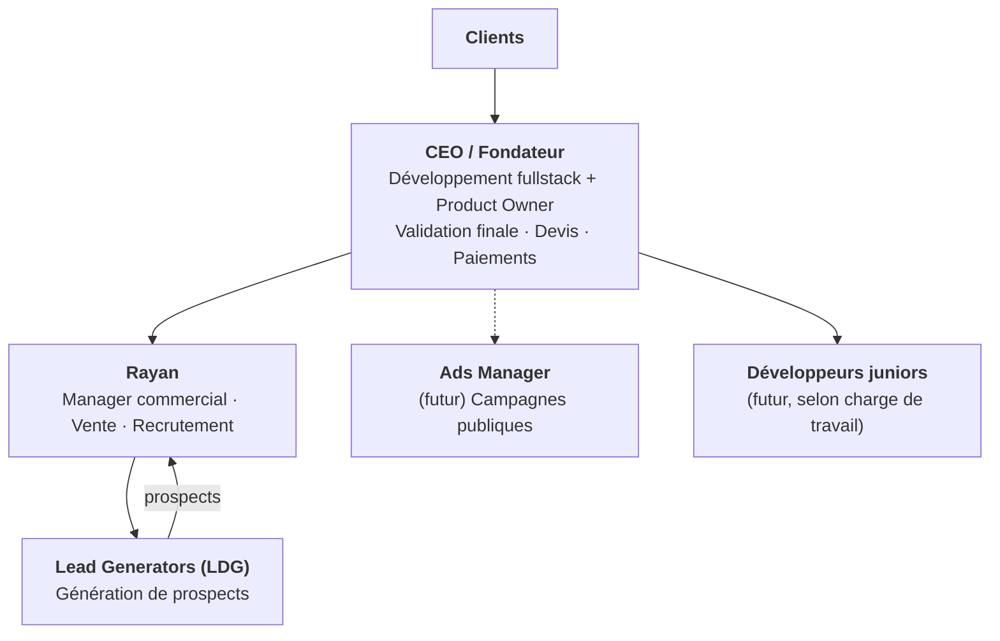
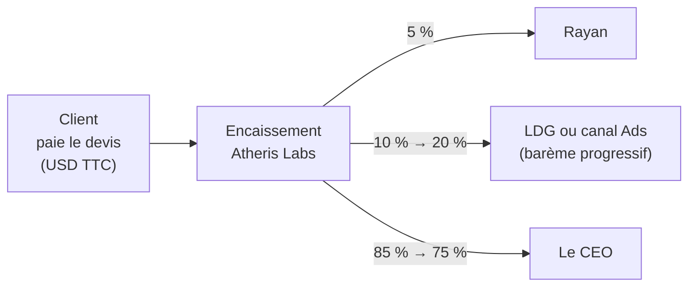
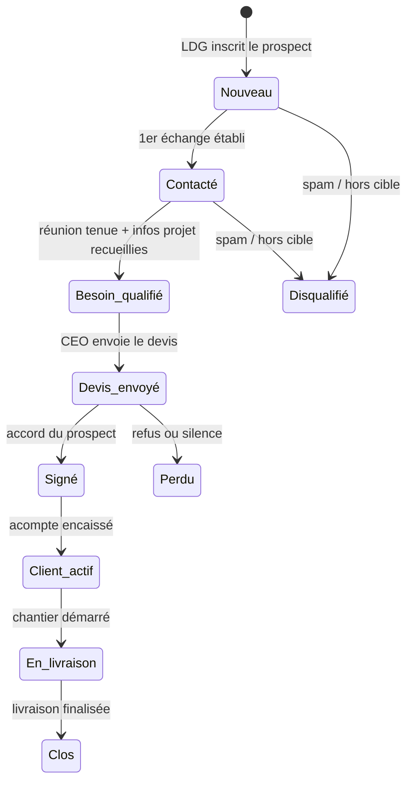

# ATHERIS LABS — Structure de l'entreprise & de la plateforme

> Document de référence **théorique** (zéro détail technique).
> Version 1.0 — 24/10/2026

---

## 1. En bref

**Atheris Labs** est un studio d'ingénierie logicielle multi-plateformes (**Web, Mobile, Desktop**) qui exploite l'IA pour livrer très vite. Son moteur de croissance est une **force de vente motivée à la commission**, bientôt complétée par de la **publicité payante**.

**Le modèle économique tient en une phrase** : un client paie un devis en **USD TTC** → la plateforme encaisse → **le CEO touche entre 75 % et 85 %**, le reste rémunère les ventes (LDG ou canal Ads : 10 % → 20 %, Rayan : 5 %).

---

## 2. L'organisation

| Rôle | Responsabilités | Rémunération |
|---|---|---|
| **CEO** | Développement, vision produit, devis, finalisation des ventes, encaissement, paiement des commissions, sélection des inscriptions · **stats globales de l'entreprise et de chaque employé** | 75 % → 85 % de chaque deal (le solde) |
| **Rayan** | Recrutement des LDG, management de l'équipe de vente, vente directe — **accès double : interfaces Manager et Commercial** | **5 % fixe** sur chaque deal (tous canaux) + **part vendeur 10 % → 20 %** (barème progressif) sur les prospects qu'il génère lui-même |
| **Lead Generator** | Générer des prospects par tous les moyens autorisés, les inscrire sur la plateforme | **10 % → 20 %** (barème progressif §3) |
| **Ads Manager** *(futur)* | Campagnes publicitaires, génération de leads entrants | Comme un LDG : **10 % → 20 %** sur les leads Ads convertis |
| **Développeurs juniors** *(futur)* | Production, sous le CEO | Salaire — recrutés uniquement si le CEO est surchargé |

**Règles d'équipe**
- Toute inscription sur la plateforme est **validée manuellement par le CEO** (pas d'accès libre).
- Rayan touche sa commission **en plus** de celle du LDG — jamais l'inverse : le cumul LDG + Rayan est **plafonné à 25 %** par deal (§3).

---

## 3. Le moteur commercial

### 3.1 Flux de l'argent

### 3.2 Base & conditions de la commission

| Règle | Détail |
|---|---|
| Base de calcul | **Montant TTC du devis signé**, en **USD** |
| Déclencheur | Signature du devis **ET** encaissement du **premier versement** (acompte) |
| Non-signature | **Aucune** commission |
| Annulation après paiement | **Aucun remboursement** : la commission est définitivement acquise (voir risques §7) |
| Paliers | Comptés sur le cumul de clients ayant **payé l'acompte**, par vendeur |

### 3.3 Barème progressif vendeur

| Clients signés cumulés | Taux vendeur | Cumul vendeur + Rayan | Part du CEO |
|---|---|---|---|
| 0 – 4 | 10 % | 15 % | **85 %** |
| 5 – 9 | 12,5 % | 17,5 % | **82,5 %** |
| 10 – 19 | 15 % | 20 % | **80 %** |
| 20 et + | 20 % | **25 % (plafond)** | **75 %** |

- Le palier s'applique aux **deals futurs uniquement** (jamais rétroactif).
- Le cumul vendeur + Rayan **ne peut jamais dépasser 25 %** : au-delà du palier, c'est la part du CEO qui aurait baissé, pas le plafond qui monte.

**Rayan vendeur** : quand Rayan génère lui-même un prospect et le convertit, il touche **sa commission de manager (5 %) + la part vendeur selon le barème** (10 % → 20 %), plafond cumulé de 25 % inclus.

**Rayan clôture un prospect d'un LDG** : la part vendeur reste au **LDG** (la commission suit le canal d'origine, §3.4) ; Rayan touche alors uniquement ses 5 % de manager.

### 3.4 Attribution des prospects

| Situation | Règle |
|---|---|
| Prospect déjà sur la plateforme (même email ou téléphone) | **Ajout bloqué** — le formulaire renvoie « prospect déjà existant » |
| Deux vendeurs réclament le même prospect | Le canal d'origine (source déclarée à l'inscription) l'emporte |
| Lead venu d'une campagne Ads | Attribué au **canal Ads** → commission type LDG, même barème |
| Prospect déjà client ou en discussion | Hors attribution, bloqué à l'ajout |

---

## 4. Cycle de vie d'un prospect

### 4.1 Le pipeline

| Statut | Signification |
|---|---|
| **Nouveau** | Ajouté par un vendeur, aucun échange |
| **Contacté** | Premier contact établi |
| **Besoin qualifié** | Réunion faite, fiche projet renseignée |
| **Devis envoyé** | Devis transmis, réponse attendue |
| **Signé** | Prospect d'accord, paiement en attente |
| **Client actif** | Acompte encaissé → **commission déclenchée** |
| **En livraison** | Projet en cours (suivi visible côté client) |
| **Clos** | Livraison finalisée, dossier archivé |
| **Perdu** | Ne signera pas |
| **Disqualifié** | Spam, hors cible, budget inexistant |

### 4.2 Qui fait quoi

| Action | LDG / Ads | Commercial | Rayan | CEO |
|---|---|---|---|---|
| Ajouter un prospect | ✅ | ✅ | ✅ | ✅ |
| Passer à *Contacté / Besoin qualifié* | ❌ lecture seule | ✅ | ✅ | ✅ |
| Renseigner la fiche projet | ❌ | ✅ | ✅ | ✅ |
| Passer à *Devis envoyé / Signé* | ❌ | ❌ | ❌ | ✅ |
| Enregistrer l'acompte (*Client actif*) | ❌ | ❌ | ❌ | ✅ |
| Marquer *Perdu / Disqualifié* | ❌ | ✅ | ✅ | ✅ |
| Payer une commission | ❌ | ❌ | ❌ | ✅ |

### 4.3 Les trois statuts, séparés

1. **Avancement du dossier** — le pipeline ci-dessus.
2. **Commission vendeur** — `Non éligible` → `Due` (acompte encaissé) → `Versée`.
3. **Paiement client** — `Devis` → `Acompte reçu` → `Échéances` → `Soldé`.

---

## 5. Les espaces de la plateforme

| Espace | Accès | Contenu |
|---|---|---|
| **Landing** | Public | Présentation, demande de devis |
| **Inscription** | Sur sélection du CEO | Candidature, validation manuelle |
| **CEO** | CEO | Pipeline complet · devis · statuts · commissions dues et versées · **dashboard global de l'entreprise** · **stats par employé** (funnel + activité + rentabilité) |
| **Manager** | Rayan | **Espace complet Manager** : stats par LDG · pipeline des ventes · commissions de son équipe · pipeline de recrutement — **+ espace Commercial complet** (accès double : mêmes écrans et actions qu'un commercial, §4.2) |
| **Commercial** | Commerciaux | Prospects de tous les LDG · fiche projet · relances · dashboard |
| **Vendeur** | LDG & Ads Manager | Ses prospects et leur statut · son palier en cours · ses gains (en attente / versés) · profil (email, téléphone, mot de passe) |
| **Client** | Par invitation, après signature | Suivi d'avancement par jalons (Cadrage → Design → Développement → Recette → Mise en ligne) · validation d'étapes · documents (devis signé, contrat, factures, livrables) · paiements · messagerie · profil |

### 5.1 Fiche projet (page clé du Commercial)

| Bloc | Contenu |
|---|---|
| **Prospect** | Nom, entreprise, poste, email, téléphone, canal d'origine |
| **Besoin** | Problème business, type de produit, périmètre et fonctionnalités prioritaires, utilisateurs cibles |
| **Contraintes** | Délai souhaité, budget validé, décideurs, références |
| **Technique** | Technologies imposées, intégrations, hébergement, exigences de sécurité |
| **Suivi** | Prochaine étape et date de relance, notes d'échange, documents joints, historique des statuts |

### 5.2 KPIs par dashboard

| Rôle | Indicateurs |
|---|---|
| **CEO — global** | CA encaissé, pipeline en valeur, devis envoyés, taux de conversion, commissions dues / versées, activité de l'équipe |
| **CEO — par employé** | Funnel : prospects ajoutés / qualifiés / signés, taux de conversion, commission due et versée · Activité : dernière connexion, relances faites, temps de réponse · Rentabilité : CA généré, commissions coûtées, marge nette apportée |
| Rayan | Performance par LDG, conversion par vendeur, activité d'équipe + son propre palier et ses ventes |
| Commercial | Prospects qualifiés, devis préparés, relances dues |
| Vendeur | Prospects ajoutés, signés, palier en cours, gains en attente / versés |
| Client | Étape en cours, prochain jalon, échéances de paiement |

---

## 6. Évolutions (phase 2)

- Notifications email + in-app à chaque changement de statut.
- Analyse de rentabilité par canal (coût d'acquisition Ads vs deals signés).
- Module maintenance / retainer (revenus récurrents après livraison).
- Relances automatiques (devis sans réponse sous X jours).
- Multi-devises pour les paiements clients.

---

## 7. Risques & garde-fous

- **Commission sans clawback** : si un client paie l'acompte puis annule, la commission reste versée — veiller à un acompte suffisant pour couvrir les frais engagés.
- **Fraude vendeurs** : l'ajout de prospects bidons peut gonfler les stats — dédoublonnage strict (§3.4) et encaissement validé par le CEO avant toute commission.
- **Réputation** : « par tous les moyens » ne doit jamais virer au spam — canaux et messages encadrés par Rayan.
- **Dépendance au CEO** : développeur, product owner et vendeur final — le recrutement de juniors est le premier filet.
- **Conflit d'attribution Ads** : la règle « le canal d'origine l'emporte » doit être appliquée sans exception.
